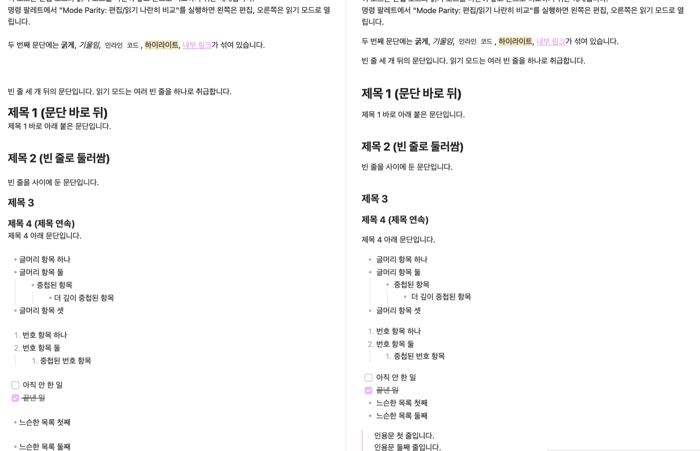
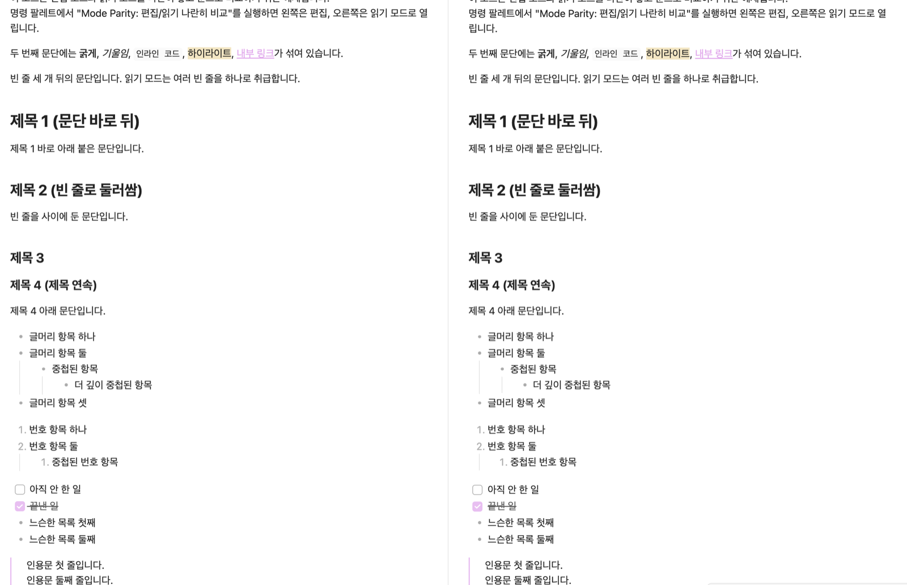
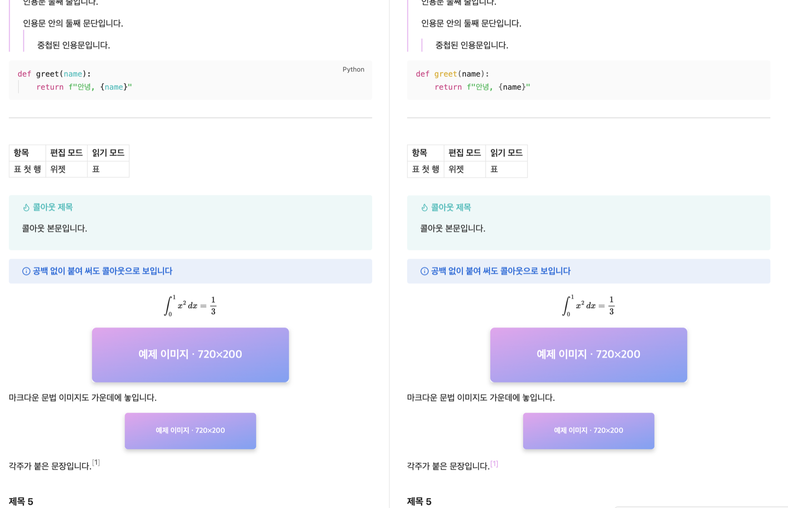
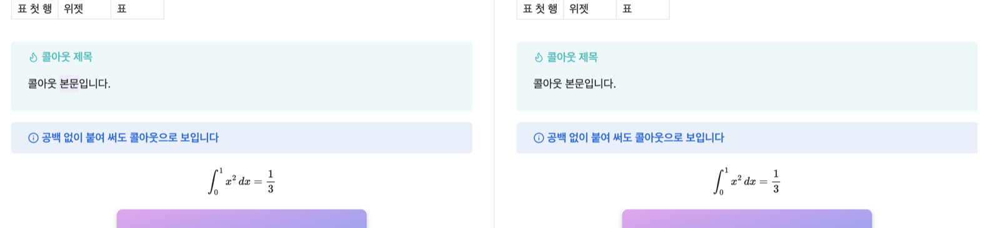

# Mode Parity

Make **Live Preview line up with Reading view to the pixel**, and **edit callouts while they stay rendered**.

In stock Obsidian the same note looks different in the two modes: blank lines take a full line in Live Preview but collapse in Reading view, headings and lists sit at different offsets, code blocks grow when you click into them, and a callout turns back into raw `> [!tip]` text as soon as the cursor enters it. Mode Parity removes those differences.

[한국어 설명은 아래에 있습니다.](#한국어)

## Before / after

Left: Live Preview. Right: Reading view. Same note, same scroll position.

**Without the plugin**: blank lines, headings and lists drift apart.



**With the plugin**: every block starts at the same pixel.



Code, dividers, tables, callouts, math and images line up too:



Editing inside a callout (left, the word is selected) keeps it rendered exactly like Reading view (right):



## What it does

| Area | Stock Live Preview | With Mode Parity |
| --- | --- | --- |
| Blank lines | Every blank line is a full line tall | The blank line between two blocks uses the Reading-view gap (e.g. paragraph 16px, paragraph → heading 40px). Extra blank lines you add keep a full line of space by default; turn on **Collapse extra blank lines** to collapse them like Reading view |
| Headings | Only 1rem above | Same top/bottom spacing as Reading view, depending on the previous block |
| Lists | Bullet and text positions differ, loose lists get extra gaps | Bullet center and text start match, nested list padding matches |
| Blockquotes | Different indent, `>` shown on the active line | Reading-view indent, `>` hidden |
| Code blocks | Different line height; fences (```) appear and the block grows when you click in | Same line box and baseline; a fence only appears when the cursor is on that fence line |
| Dividers, tables, math | Widget boxes have different heights/padding | Same boxes as Reading view |
| Footnote references | Small `[^1]` | Superscript `[1]` like Reading view |
| Images | Stuck to the left inside a shrink-wrapped box | Centered in both views (optional); image-only lines are exactly as tall as the image |
| **Callouts** | Clicking in shows raw `> [!tip] Title` | **Stays rendered while you edit**; the cursor lands on the character you clicked. Click the icon, or press ← at the start of the title, to edit the type |
| Callouts without a space (`>[!info]Title`) | Obsidian treats them as plain quotes | Rendered as callouts in both views (optional). Files are not changed |
| Editing a heading | `##` appears and pushes the heading text right | `##` hangs in the left margin, the text does not move |

## How it works

- **Calibration**: a hidden Reading-view probe renders sample blocks (paragraph, headings 1–6, lists, quote, callout, code, math, table, divider) in every order with Obsidian's own renderer and measures the real gaps. It re-measures when the theme or a CSS snippet changes, so it follows your theme's Reading view rather than hard-coded numbers.
- **Block classification**: Markdown lines are grouped into blocks (recursively inside quotes and callouts), and the height of blank lines and the space above blocks are set from the measurements.
- **CodeMirror decorations + CSS**: line decorations apply the heights and gaps, and the list/quote marker areas are given the Reading-view width (Obsidian's own wrapped-line indentation follows automatically).

## Commands

- **Toggle on/off (before/after)**: switch instantly to compare.
- **Open editing and reading side by side**: opens the current note in Live Preview (left) and Reading view (right) with linked scrolling.
- **Measure editing vs reading offsets**: measures where the same text lands in both panes and lists the difference per line in pixels.
- **Re-measure current theme**

Every feature can be turned off individually in the settings.

## Verified

On Obsidian 1.15.1 with the default theme, comparing the position of the same text on every line of a test note:

- Without the plugin: up to **168px** vertical and **12px** horizontal difference
- With the plugin: at most **0.1px** vertical and **0.6px** horizontal (task checkboxes); images 0px; 0px while editing inside a callout

## Known differences

- Syntax highlighting colors differ slightly (CodeMirror in Live Preview vs Prism in Reading view).
- The code block language label is only shown in Live Preview.
- Footnote definitions (`[^1]: …`) stay in place in Live Preview; Reading view moves them to the end.
- Inline formatting marks (`**` etc.) still appear around the cursor, as in stock Obsidian.
- Pixel-verified only with the default theme; other themes are calibrated automatically but not verified by hand. Not yet tested on mobile.
- In very narrow panes the hanging `##` marks can be clipped.

## Installation

Until it is listed in the community directory, install manually: download `main.js`, `manifest.json` and `styles.css` from the latest release into `<vault>/.obsidian/plugins/mode-parity/`, then enable **Mode Parity** under Settings → Community plugins.

## License

[MIT](LICENSE)

---

## 한국어

편집 모드(Live Preview)를 읽기 모드와 **같은 픽셀 위치**로 맞추고, 콜아웃처럼 커서를 넣으면 원문으로 바뀌던 블록을 **렌더링된 모양 그대로 편집**하게 해 주는 Obsidian 플러그인입니다.

- **블록 간격**: 빈 줄·제목·목록·인용·코드·구분선·표·수식·각주 표시의 위치를 읽기 모드와 같게 맞춥니다. Enter로 추가한 빈 줄은 기본적으로 한 줄씩 공간을 유지하고, 설정의 **연속 빈 줄 접기**를 켜면 읽기 모드처럼 접힙니다.
- **렌더링된 채로 편집**: 콜아웃 안을 클릭하면 클릭한 글자에 바로 커서가 들어가고 모양은 그대로입니다. 아이콘을 누르거나 제목 맨 앞에서 ←를 누르면 `[!종류]`를 고칠 수 있습니다. 코드 블록은 ``` 줄에 커서를 둘 때만 그 줄이 나타나고, 편집 중인 제목의 `##`는 왼쪽 여백에 표시됩니다.
- **이미지 가운데 정렬**, **붙여 쓴 콜아웃(`>[!info]제목`)도 콜아웃으로** 그리기(둘 다 설정에서 끌 수 있음, 파일 내용은 바꾸지 않음)
- **측정 기반**: 현재 테마의 읽기 모드를 실제로 그려서 간격을 재므로 다른 테마에서도 그 테마 기준으로 맞춥니다.

Obsidian 언어가 한국어면 설정과 명령이 한국어로 표시됩니다. 명령 팔레트에서 **편집/읽기 나란히 비교**로 두 모드를 나란히 열고, **편집/읽기 위치 차이 측정**으로 줄마다 차이(px)를 확인할 수 있습니다.

검증: Obsidian 1.15.1 기본 테마에서 적용 전 세로 최대 168px → 적용 후 0.1px. 기본 테마 외의 테마와 모바일은 아직 직접 확인하지 않았습니다.
